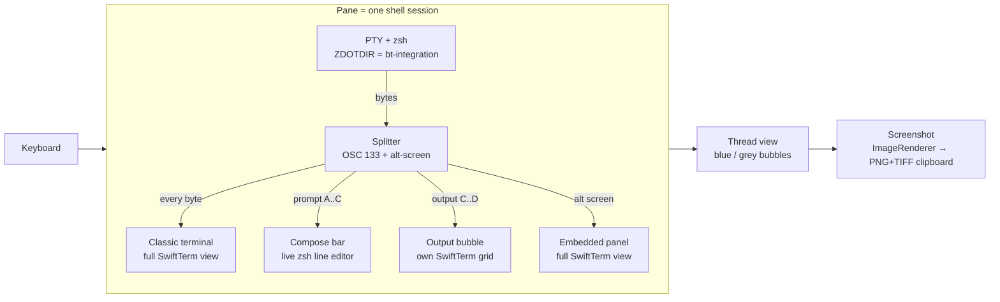

# Architecture: Better Terminal (`better-terminal`)

**Stage:** 2 · Design (approved by CEO 2026-10-15; install ops-only ~/Applications)  **Date:** 2026-10-15  **Authors:** Eng, UX, SRE  **Inputs:** [brief.md](brief.md), [discovery.md](discovery.md)

Confidence legend: **V** = verified here 2026-10-15 · **M** = from memory (unverified) · **B** = verify at Build.

## Gate inputs (CEO, 2026-10-15)
Discovery approved:
- Native SwiftUI + SwiftTerm, macOS only.
- Claude Code chat mode (R11) is **v2** and uses the CEO's existing Claude Code login (no new API key).
- Requirements carried from the brief: full terminal parity, split panes and tabs, a classic-view kill switch, one live bubble per progress bar, colour and background settings, and a screenshot to the clipboard.

**Build deviations (M1, 2026-10-15):**
- The zsh integration ships as a Swift string. It is rewritten on each launch to `~/Library/Application Support/BetterTerminal/zsh-1/`, not into the app bundle, because SwiftPM resource bundles break the `.app` signature.
- **Full-terminal panel in M1 = the pane switches to the classic view while the program runs**, then returns to bubbles and leaves a chip. The framed in-thread panel is M3 polish.
- Output bubbles are as wide as the pane (minus margins), so the PTY column count matches the classic view and no line wraps differently. The 85% maximum applies to blue bubbles only.
- The thread always follows the bottom while output arrives. "Stay where I scrolled" is M3.
- The compose terminal mutes its own replies to terminal queries (overrides `send(source: Terminal…)`), so the shell gets exactly one answer, from the classic view.
- Unit tests need `-load-plugin-library` for the swift-testing macros under Command Line Tools only. The Makefile handles it.

**Build deviations (M2, 2026-10-15):**
- **One active theme instead of separate light and dark colour sets.** Presets cover both looks (iMessage Light / iMessage Dark / Midnight / Paper). The classic view keeps the system light/dark look on purpose, since it's the "original look".
- **Screenshots draw the terminal parts themselves.** SwiftTerm's text layers can't be read by `cacheDisplay` or `CALayer.render(in:)` (they came back transparent). Each pane keeps a small shadow copy of its compose bar and classic view and paints that text into the image. The bubbles, background and everything else come from the layer tree.
- The compose bar is cleared with a soft reset (DECSTR) + clear, not RIS.
- `@State` is avoided: on the macOS 27 SDK it's a macro whose plugin ships with Xcode only, not the CLT. We use `@StateObject` instead.
- Focus follows clicks through an event monitor, because SwiftTerm doesn't let subclasses override `becomeFirstResponder`.
- Not done yet: the "+" button in the native tab bar. ⌘T and View ▸ Show Tab Bar work.

**Build deviations (M3, 2026-10-15):**
- **The in-thread panel is the pane's one classic terminal, moved into a framed card** over the lower ~78% of the thread. History stays visible above it and a hint bar replaces the compose bar. It isn't a scrolling thread item, because a terminal view can't be safely re-parented between SwiftUI containers. vim gets the card's size through the PTY. When the program exits, the card goes away and the chip stays in the thread.
- Follow-bottom uses a scroll-wheel monitor (scrolling up = stop following) plus visibility of the bottom marker. A new command always jumps to the bottom.
- ⌘F in bubble view searches commands and output and highlights matches (it expands collapsed output if the match is hidden). In classic view, or while the panel is up, ⌘F opens SwiftTerm's own find bar.
- The Edit menu's system text-editing group (Find, Spelling, Substitutions…) is replaced by our Find items. The terminal doesn't use the others.
- New shells get `PWD` set, so a split or tab opened from `/tmp` shows `/tmp`, not `/private/tmp`.

**Audit changes (0.4.0, 2026-10-15):** see `docs/reports/2026-10-15-better-terminal-audit.md`.
- Our shell marks carry a per-session nonce (`BT_NONCE`): `133;A|C|D;…;bt=<nonce>` and `1337;BTCmd=<nonce>;<base64>`. Marks from other tools and fakes printed by programs are ignored. The integration is now v2.
- The splitter follows xterm: an ESC, CAN or SUB inside an unfinished sequence ends it.
- Closing a pane sends SIGHUP to the shell (zsh ignores SIGTERM).
- Live bubbles convert only the screen area per refresh (settled history is cached). The cache drops on resize and on clear or alternate-screen switches.
- Finished output per pane is capped at 50,000 lines (older bubbles keep their first 10 + last 20). An expanded bubble shows at most its last 2,000 lines.
- Background images are downsampled once (≤2560 px, or ≤960 px when blurred), and the blur is pre-rendered.
- The in-thread panel uses the theme's output colours. The full classic view keeps the system look.
- New windows open on the display with the pointer.

**Operate changes (0.4.3, CEO-approved cut list, 2026-10-15):** removed theme Export/Import, the gradient background (Midnight is now solid #0E1326; older saved gradient themes load as solid), and the ⌘⌥⇧S shortcut (the menu item stays).

## How it plugs into the Platform
| Item | v1 value |
|---|---|
| Hostname / port / listener | **None.** It's a desktop app with no socket and no daemon |
| Runs as | `ops`, in the GUI session (Jump Desktop), when opened |
| Install | `~/Applications/Better Terminal.app` (ops only, ad-hoc signed). `tv` doesn't get it |
| Auth | The macOS login |
| Network | None. It links no networking code and has no update checker, analytics or crash upload (test T10) |
| Models | None in v1. v2 chat mode runs the CEO's own `claude` CLI as a child process (existing login) |
| Dashboard entry | None |

## Verified building blocks (Design spikes, V)
| Need | How | Evidence |
|---|---|---|
| Split input from output | zsh hooks emit OSC 133 `A/B/C/D;exit`, injected through `ZDOTDIR` | Discovery S1: 4/4 commands, correct exit codes |
| Emulate a terminal per bubble | SwiftTerm `Terminal` / `HeadlessTerminal` + `feed(byteArray:)` | SwiftTerm `37cc25e` (2026-10-15), MIT; APIs found in source |
| Detect full-screen programs | `Terminal.isCurrentBufferAlternate`, delegate `bufferActivated(source:)` | same |
| Native OSC 133 awareness | SwiftTerm `SemanticPrompt.swift` (`semanticPromptMarks(at:)`, `semanticRowKind(at:)`) | same; we still run our own splitter (below) because we need byte-level routing |
| Screenshot | SwiftUI `ImageRenderer` of the pane's own view, no Screen Recording permission | Discovery S2 |
| Clipboard | `NSPasteboard` write + read-back OK. `NSImage` alone writes **TIFF only**, so v1 writes PNG + TIFF explicitly | Design spike: `write ok: true`, types `[public.tiff]` |
| Toolchain | Swift 6.4 CLT, `swift build`, no Xcode | Discovery S2 |

SwiftTerm's SwiftPM dependencies are swift-argument-parser, swift-docc-plugin and swift-png (all open source). SwiftPM fetches them at build time and pins them in `Package.resolved`. We pin SwiftTerm to a release tag (B: pick the tag at Build).

## Components


### 1. Session (one per pane)
- One PTY runs the CEO's login shell (`/bin/zsh -l`) with `ZDOTDIR` pointed at the app's integration folder. That folder's `.zshrc` first sources the CEO's real `~/.zshrc`, then adds the hooks. **Nothing in `~` is edited.**
- `TERM=xterm-256color` and `TERM_PROGRAM=BetterTerminal`.
- The integration emits:
  - `133;A` / `133;B` around the prompt
  - `133;C` + **`1337;BTCmd=<base64 of $1>`** in `preexec`. This gives the exact command text for the blue bubble, the same idea as VS Code's `633;E`.
  - `133;D;$?` as the **first** line of `precmd`
  - `unsetopt PROMPT_SP`, which fixes the Discovery S1 gotcha
- Nested local zsh inherits `ZDOTDIR`, so bubbles keep working inside it.

### 2. Splitter (the core, pure Swift, unit-tested)
A byte-stream state machine with these states: `prompt` (A..C), `running` (C..D) and `fullscreen` (alt screen active). It never drops or rewrites bytes. It only **routes** them:
- **Every byte** also goes to the pane's **classic terminal**, which is always up to date. That's why the kill switch is instant and lossless (R5).
- `A..C`: goes to the **compose bar**.
- `C..D`: goes to the current **output bubble's** own `Terminal` instance (R2).
- `ESC[?1049h` / `47h` / `1047h` while running: the bubble becomes an **embedded panel** that is a full terminal, until `…l`. Then normal bubbles resume.
- Fallbacks:
  - No `C` within 2 s of Enter (a shell without the integration, or a broken hook): show a warning chip "bubbles unavailable here" and render that pane in classic view.
  - A `D` with no `C`: ignore it (the spurious first `D` from S1).

### 3. Compose bar (input)
- The CEO types into the **real zsh line editor**, not a text field. The bar is a small terminal view showing the live prompt region (A..C). That keeps tab completion, history, Ctrl-R, autosuggestions, vi mode and multi-line input exactly as they are today (R3).
- On Enter, the command text from `BTCmd` becomes a **blue bubble** on the right.
- While a command is running, keystrokes go straight to it (for y/n prompts, passwords, Ctrl-C). The bar shows "↳ typing to `<cmd>`".

### 4. Output bubble (live redraw)
- Each output bubble has its own SwiftTerm `Terminal`, with the pane's width in columns and the pane's height in rows, plus scrollback.
- `\r`, cursor-up, erase-line, colours and bold all edit that grid in place. **A progress bar is one bubble that updates** (R2).
- The view shows the grid trimmed of trailing blank lines and redraws at most 30 fps.
- While running, the bubble has a pulsing "live" dot. On `D` it freezes and gains a footer: `✓ 0.8 s`, or `✗ 1 · 0.8 s` with a red tint on the badge (R8).
- Output over **N = 40 lines** (setting) collapses to the first 10 and last 20 lines, with "Show all (1,234 lines)" between them (R9).
- Text is selectable and copyable. Links (OSC 8 and plain URLs) are clickable.

### 5. Programs that need a whole screen (R4)
| Kind | Detection | Shown as |
|---|---|---|
| Full-screen (vim, htop, less, man, fzf) | alt screen on | **Embedded panel** inside the thread. It's a full terminal, framed like a large grey bubble with the theme background, focused for keys. When it exits, it shrinks to a one-line chip ("vim notes.txt · 4 min") |
| Inline redrawing UIs that don't use the alt screen, **Claude Code included** (M: it draws in place with cursor moves), npm/yarn TUIs | name match on a **session list** (setting): `claude`, `ssh`, `mosh`, `tmux`, `screen`, `docker … -it`, `kubectl exec -it`, `bash`, `su`, `sudo -i` | Embedded panel, same as above. The CEO can edit the list |
| Everything else | default | Output bubble |

v2: Claude Code **chat mode** (separate command `⌘⇧K`, "New Claude chat") runs `claude -p --input-format stream-json --output-format stream-json --verbose` **without `--bare`**, so it uses the existing login (B: confirm that it doesn't ask for an API key). Your turns are blue bubbles, Claude's replies are grey, and tool calls are collapsible grey cards.

### 6. Window, tabs, splits
- Tabs: native macOS window tabs (`⌘T`, `⌘⇧[ ]`, drag out to a new window).
- Splits: `⌘D` vertical and `⌘⇧D` horizontal (iTerm2 habits), drag dividers, `⌘⌥←→↑↓` to move focus, `⌘W` closes a pane.
- Each pane has its own session, thread and view mode.
- Standard keys: `⌘C/⌘V`, `⌘F` find in thread, `⌘K` clear thread (keeps the shell), `⌘+/-` font size.
- A new tab opens in the current pane's directory (OSC 7, B).

### 7. Classic-view kill switch (R5)
| Control | Scope |
|---|---|
| Toolbar toggle 💬 / ▤, `⌘\` | Current pane |
| View ▸ Classic view everywhere, `⌘⇧\` | All panes and windows. The choice persists |
| Hold **Option** while launching | Starts in classic view everywhere (safe mode in case bubble rendering breaks) |
| Settings ▸ General ▸ Default view | Bubbles / Classic for new panes |

The switch only swaps which view is on screen. The classic terminal has received every byte all along (Splitter rule 1), so nothing is lost or replayed.

### 8. Screenshot to clipboard (R7)
- `⌘⇧S` or the camera button renders the **focused pane's visible part of the thread** with `ImageRenderer` at 2x. It writes **PNG + TIFF** to the clipboard, flashes the pane and shows a toast: "Screenshot copied".
- The menu also has "Copy screenshot of whole window" (all panes).
- In classic view the same command captures the classic terminal.
- Nothing goes to disk.

## Settings (R6)
Stored in `UserDefaults` (`~/Library/Preferences/com.mini.better-terminal.plist`), with **Export / Import theme** as JSON.

| Group | Settings (default) |
|---|---|
| Bubbles | My bubble colour (iMessage blue `#0A84FF`) + text (white). Output bubble (light grey `#E9E9EB` / dark `#3A3A3C`) + text. Error badge (red `#FF453A`). Corner radius (18). Max bubble width (85%) |
| Background | Solid colour (system background) / gradient (2 colours) / **image** (chosen with a file picker, copied into `~/Library/Application Support/BetterTerminal/backgrounds/`) with blur 0–30 and dim 0–80% |
| Text | Font (SF Mono 13), line spacing, ANSI palette (from the theme, or the macOS Terminal default) |
| Thread | Timestamps (on hover / always / off), exit badge (on), collapse after N lines (40), session list (editable) |
| Presets | iMessage Light, iMessage Dark, Midnight, Paper. "Reset to default" |
| General | Default view (Bubbles), shell (`/bin/zsh`), scrollback per pane (10,000 lines), save transcripts (**off**) |

Light and dark mode follow macOS, with separate bubble colours for each.

## Data
| Data | Location | Backed up? | Notes |
|---|---|---|---|
| Settings + themes | `~/Library/Preferences/com.mini.better-terminal.plist` | Time Machine if enabled; export JSON for manual backup | no secrets |
| Background images | `~/Library/Application Support/BetterTerminal/backgrounds/` | same | copies of files the CEO picks |
| Scrollback / threads | **memory only** | no | lost on quit by design (R12). "Save transcripts" (off) would write to `…/BetterTerminal/transcripts/`, 600 |
| zsh integration | inside the .app bundle (`Contents/Resources/zsh/`) | git | read-only |

## UX sketch (core tasks)
1. **Run a command:** type in the bar at the bottom as usual, press Enter. Your command appears as a blue bubble on the right. The output streams into a grey bubble on the left, and a progress bar keeps updating in the same bubble. When it finishes, a ✓ or a red ✗ appears under it.
2. **Fall back:** press `⌘\` (or click ▤). The pane turns into a normal terminal with everything still there. Press it again to get bubbles back.
3. **Share what's on screen:** press `⌘⇧S`. "Screenshot copied" flashes, then paste into iMessage, Slack or a doc.

Mockups: [docs/img/mock-thread.png](docs/img/mock-thread.png), [docs/img/mock-settings.png](docs/img/mock-settings.png). They're rendered with SwiftUI using the default theme and synthetic content.

## Resource budget
- **RAM:** ≤ 150 MB idle with 3 panes; ≤ 400 MB peak with 10k-line scrollback per pane.
- Each finished output bubble keeps only its final text and attributes. Its emulator is released when it freezes, so memory scales with output, not bubble count.
- **CPU:** < 1% idle (no timers while nothing is running); redraw capped at 30 fps per live bubble.
- **Disk:** ~15 MB app; settings in KB; transcripts off.

## Code layout
```
products/better-terminal/
  Package.swift            # SwiftTerm pinned by tag
  Makefile                 # build / test / app (bundle + ad-hoc codesign) / install (~/Applications)
  VERSION
  Sources/BetterTerminal/  # App, Window, Pane, Thread, Bubble, ComposeBar, Settings, Screenshot
  Sources/BTCore/          # Splitter, Session (PTY), Theme. No UI imports, unit-tested
  Resources/zsh/.zshrc     # integration
  Tests/BTCoreTests/       # splitter fixtures (recorded byte streams)
  docs/img/                # mockups
```
Milestones: **M1** core (session + splitter + bubbles + compose bar + classic switch) → **M2** splits/tabs, settings, screenshot → **M3** polish (collapse, find, presets) → v1 Launch gate → **v2** Claude chat mode.

## Installs / costs requiring CEO approval
- **None.** It builds with the Command Line Tools already installed.
- SwiftPM downloads SwiftTerm and its three open-source dependencies from GitHub into the repo's git-ignored `.build/` folder.
- No sudo, no system settings, no accounts, $0.

## Test plan (end-to-end)
| # | Test | Pass |
|---|---|---|
| T1 | Splitter unit tests on recorded fixtures: plain output, `\r` progress, multi-line cursor-up (synthetic `docker pull`), alt screen, `PROMPT_SP`, Ctrl-C mid-output, a spurious `D`, a nested zsh, a shell without the integration | every byte routed as specified; the classic stream is byte-identical to the PTY stream |
| T2 | Live: `curl -o /dev/null` a large local file over `file://`, `python3 -m pip download --help`, `brew --version`, `git clone` a local repo | each is **one** output bubble; its final text matches the classic view |
| T3 | `vim`, `htop`, `less`, `man zsh`, `claude` | embedded panel; keys work; when it exits, a chip appears and bubbles resume |
| T4 | Kill switch: `⌘\` on a pane mid-command, `⌘⇧\` global, Option-launch | instant swap; nothing missing (compare text) |
| T5 | Parity: tab completion, Ctrl-R, `sudo -k` password prompt, Ctrl-C, Ctrl-Z/`fg`, 256-colour test, Unicode/emoji, paste of 1,000 lines | same as Terminal.app |
| T6 | Splits/tabs: 3 panes + 2 tabs, resize (SIGWINCH reflows), close | no crash; each pane is independent |
| T7 | Settings: change every colour, an image background with blur/dim, export→import a theme | applied live; restored after relaunch |
| T8 | Screenshot `⌘⇧S`: paste into Preview (New from Clipboard) and Notes | image = the visible thread @2x; PNG type present |
| T9 | Memory/CPU: 3 panes idle 10 min; `yes \| head -n 200000` in one pane | ≤ 150 MB idle, ≤ 400 MB peak, idle CPU < 1% |
| T10 | Privacy: `lsof -i -a -p <pid>` shows nothing; `nettop` 10 min shows no traffic; no files written outside Preferences/App Support | all clean |
| T11 | `~/.zshrc` untouched (checksum before/after) | identical |
